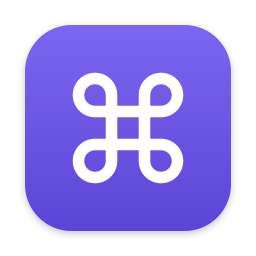
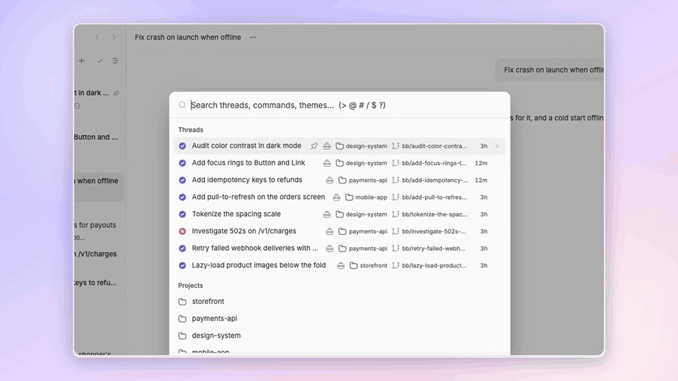
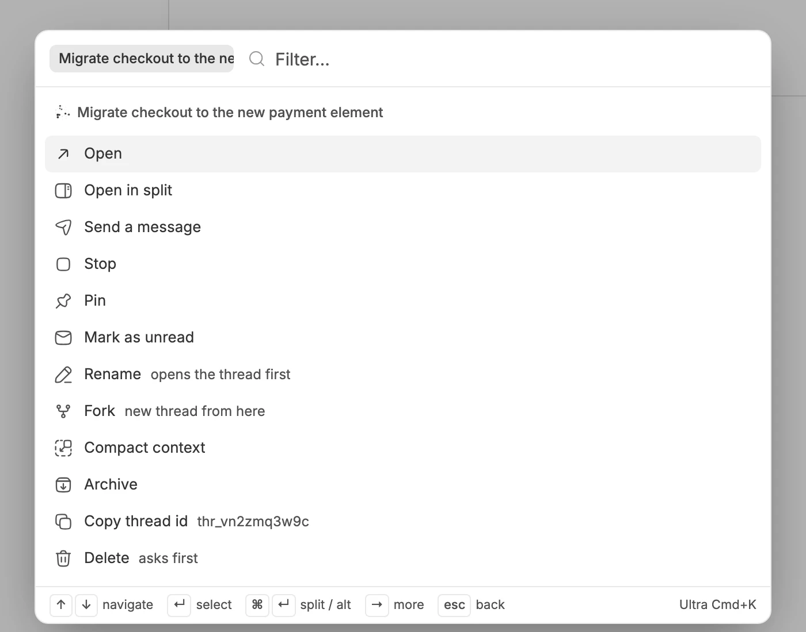
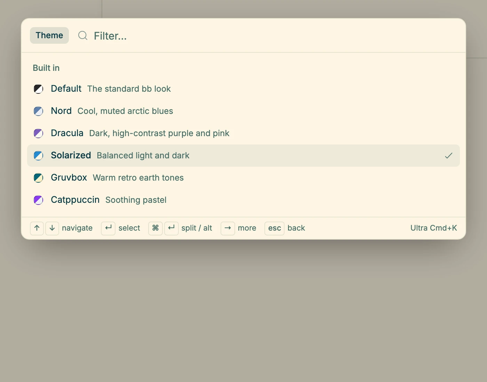
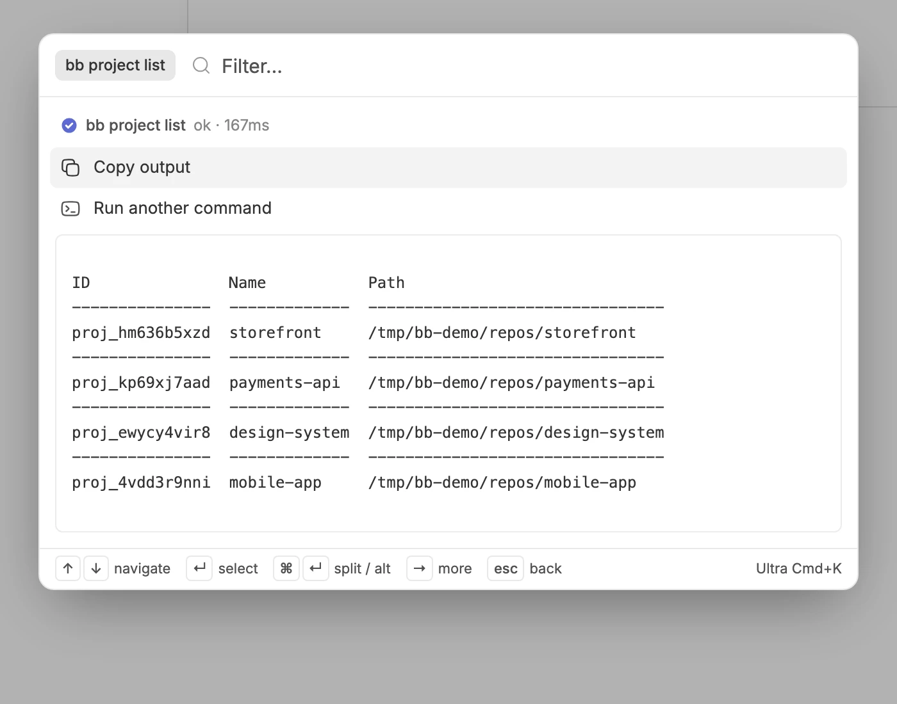

<p align="center">
  
</p>

<h1 align="center">Ultra Cmd+K</h1>

<p align="center">
  <strong>One shortcut for everything in BB.</strong>
</p>

<p align="center">
  <a href="#highlights">Highlights</a> ·
  <a href="#screenshots">Screenshots</a> ·
  <a href="#installation">Installation</a> ·
  <a href="#development">Development</a>
</p>

<p align="center">
  
</p>

Ultra Cmd+K is a command palette for BB. Press ⌘K (Ctrl+K on Windows and Linux) on any screen to find a thread or project, act on a thread, switch themes, run a BB command, or run the `bb` CLI, without leaving the keyboard.

## Highlights

- 🔎 **Everything in one list.** Search threads, projects, themes and commands together, or narrow with `>` commands, `@` threads, `#` projects, `/` skills, `$` bb and `?` shortcuts.
- 🧵 **Act on a thread without opening it.** Press → to open it in a split, send a message, stop, pin, mark it read, rename, fork, compact, archive, copy its ID or delete it.
- 🎨 **Preview themes live.** Move the highlight to try a theme on the whole app, then press Esc to keep yours.
- ⌨️ **BB's commands with your shortcuts.** Every row shows its current binding and follows your changes in **Settings → Keyboard**.
- 💲 **Run `bb` from the palette.** Type `$` and a command. It runs on your primary host, and the output appears inline.
- 🧩 **Plugins and skills too.** Enable, disable or reload a plugin, read its logs, or send a skill to the current thread.

## Screenshots

<p align="center">
  
  
</p>

<p align="center">
  
</p>

## Installation

```sh
bb plugin install https://github.com/dillionverma/bb-plugin-ultra-cmd-k
```

The palette takes over ⌘K and moves BB's own quick palette to ⌘⇧P. To give ⌘K back, turn off **Take over Ctrl/Cmd+K** in **Settings → Ultra Cmd+K**, or run `bb ultra-cmd-k release`. Run `release` before you disable or uninstall the plugin, because disabling it alone leaves ⌘K with no action.

Requires BB 0.46 or later.

## Development

```sh
git clone https://github.com/dillionverma/bb-plugin-ultra-cmd-k.git
cd bb-plugin-ultra-cmd-k
npm ci
bb plugin install .
```

Run `npm test`, `npm run typecheck` and `bb plugin build` before submitting changes.

## License

[MIT](LICENSE). The bundled Hugeicons artwork is MIT as well; its copyright notice is included in the license.
